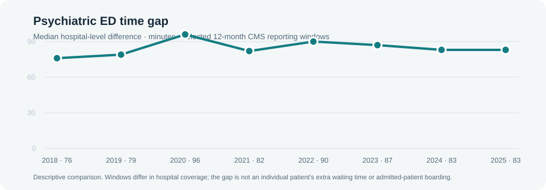

# Mental-health emergency department time in U.S. hospitals



CMS data show a persistent difference between reported emergency department times for discharged psychiatric visits and the non-psychiatric, non-transfer comparison group. The latest common hospital reporting period covered October 2024–September 2025.

## Three findings

1. **The typical hospital reported an 83-minute gap.** Across 3,023 hospitals with both measures, the median difference was 83 minutes (IQR 39–146).
2. **The driver result depends on specification.** In the baseline model, Critical Access Hospitals had a gap 17.3 minutes lower than acute care hospitals (95% CI 7.3–27.2 minutes lower). Adding certified beds, psychiatric-unit beds, and county HPSA reduced the estimate to 12.3 minutes lower (95% CI 27.9 lower to 3.3 higher). Both are exploratory associations; the expanded-model interval includes zero.
3. **The mobile-crisis authorization analysis remains inconclusive.** Using Medicaid SPA effective dates, event time zero was +3.1 minutes (state-cluster bootstrap 95% interval −9.2 to +15.7). Pre-period estimates and the later approval-date sensitivity are reported alongside it; small cohort support limits interpretation.

## Why this matters

These results can help hospitals and health systems decide where to investigate their own behavioral-health ED pathways. They do not tell a CMO how long an individual patient waited, whether a patient boarded after admission, or which hospital provides better care. The measure covers discharged ED visits and compares two separately reported hospital medians.

**[Open the interactive dashboard](https://anandiganguli97.github.io/ed-mental-health-wait-times/site/dashboard.html)** for the national trend, state and peer comparisons, model estimates, event study, and hospital search. The [hospital lookup](https://anandiganguli97.github.io/ed-mental-health-wait-times/site/hospital_lookup.html) is also available.

## Analysis and limitations

The project harmonizes 31 archived CMS releases (145,833 hospital-snapshot rows), preserving reporting periods, release dates, measure identifiers, sampled-patient counts, and footnotes. Descriptive hospital comparisons use a minimum sample threshold of 11 in each measure. Raising the threshold changes the hospitals represented: the median gap is 83 minutes at 11, 93 at 20, and 67 at 100. This is selection into different hospital groups, not evidence that larger samples remove measurement noise.

An exploratory empirical-Bayes model uses repeated annual windows to estimate how hospital gaps vary across years by sample size. In held-out-year prediction, shrinkage reduced RMSE by 2.7% for 2024 and 1.4% for 2025. Annual residual variation includes genuine hospital change as well as measurement error; these estimates are not validated sampling variances or confidence intervals for a difference of medians, and no hospital rankings are published from them.

The expanded driver model explains 5.8% of observed gap variation. It now includes CMS certified beds and psychiatric-unit beds, plus a county-level mental-health HPSA designation; HPSA is available for 76% of model hospitals and is not a hospital-specific workforce measure. These additions use 2026 sources against a 2025 outcome, so timing is imperfect. The policy analysis estimates SPA authorization timing, not verified statewide mobile-crisis operations. OP-18 is not an admitted-patient boarding measure. The current measure is being replaced by a new CMS emergency care access and timeliness measure, so the historical series is not a validated crosswalk to its successor.

## Reproduce

Install Python 3.10+ and dependencies, then run from this directory:

```powershell
python -m pip install -r python/requirements.txt
python python/download_and_build_panel.py
python python/build_historical_panel.py
python python/build_hospital_drivers.py
python python/build_shrinkage_benchmark.py
python python/build_mobile_crisis_did.py
python python/build_hospital_lookup.py
python python/build_dashboard.py
```

The archive script retrieves CMS annual hospital archives, adapts early column-name changes, and builds the longitudinal OP-18 panel. The driver script joins current CMS Hospital General Information and USDA 2023 Rural-Urban Continuum Codes to the latest period only. Raw downloads and hospital-level panels are excluded from Git; aggregate outputs are committed. The GitHub Pages workflow rebuilds the dashboard from these committed results before publishing.

## Repository map

- `analysis-plan.md` — analysis decisions and dated decision log.
- `data-quality-log.csv` — source, transformation, suppression, and linkage decisions.
- `policy/mobile-crisis-adoption.csv` — state policy dates, sources, and verification status.
- `python/` — data preparation and analysis scripts.
- `results/` — reports, aggregate tables, model outputs, and chart.
- `site/` — dashboard and rendered analysis pages.

## Data sources

CMS Timely and Effective Care (current and archived), CMS Hospital General Information, the 2026 Q2 CMS Provider of Services file, the current HRSA mental-health HPSA file, USDA Rural-Urban Continuum Codes, and state Medicaid SPA documents are used. The CMS psychiatric-unit-bed field is a facility-specific unit count; the county HPSA indicator is a geographic designation, not a direct measure of hospital staffing or nearby bed capacity.
